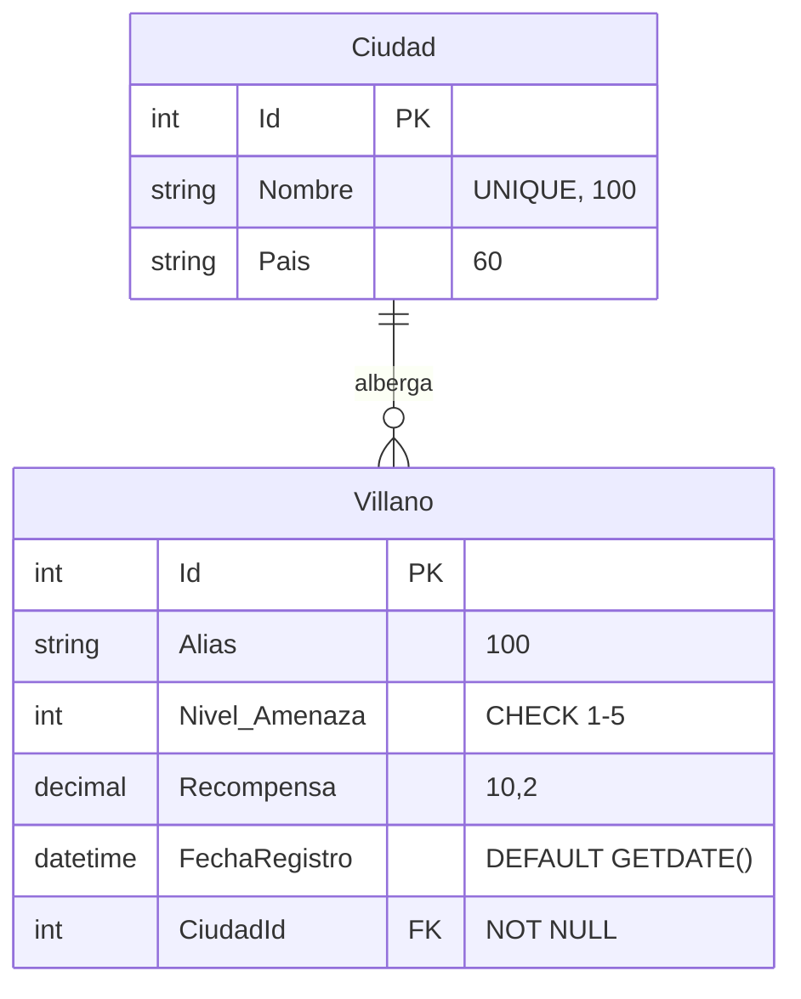
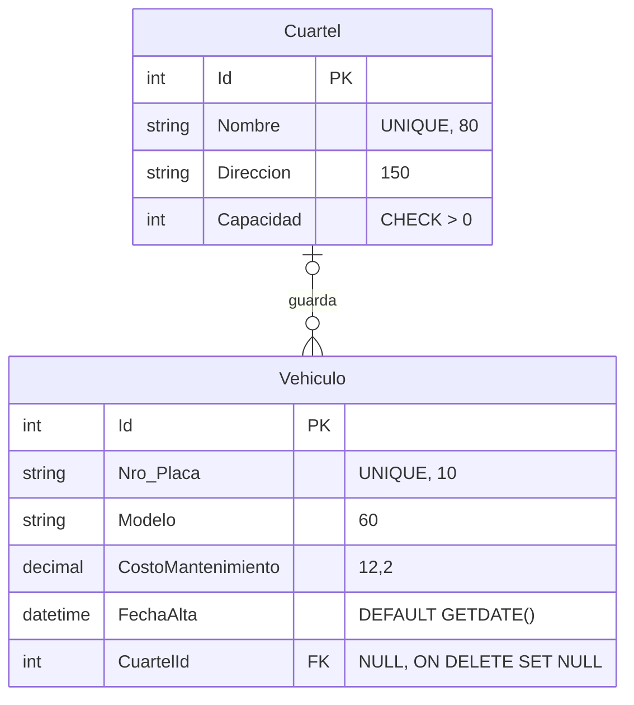

# Clase 02 – Práctica de Fluent API con archivos de configuración

Proyecto: `HeroesMvc` (ASP.NET Core MVC, .NET 10) · Contexto: `HeroesDbContext` · Base: `HeroesClase1` (SQL Server) · Sin migraciones: las tablas se crean con `Sql/01_HeroesClase1.sql`.

## Archivos entregados

| Entregable | Ruta |
|---|---|
| Script de la base | `Sql/01_HeroesClase1.sql` |
| Entidades (sin atributos) | `Models/Ciudad.cs`, `Models/Villano.cs`, `Models/Cuartel.cs`, `Models/Vehiculo.cs` (más las de la clase 2: `Equipo`, `Heroe`, `Ficha`, `Superpoder`, `HeroeSuperpoder`) |
| Configuraciones | `Data/Configurations/CiudadConfiguration.cs`, `VillanoConfiguration.cs`, `CuartelConfiguration.cs`, `VehiculoConfiguration.cs` |
| Contexto modificado | `Data/HeroesDbContext.cs` |
| Controlador de pruebas | `Controllers/LaboratorioEfController.cs` (`Relaciones`, `Ciudad`, `ModeloVillano`, `Cuartel`) |
| Pruebas SQL (con ROLLBACK) | `Sql/02_pruebas_restricciones.sql` → salida en `Docs/resultado_pruebas_D.txt` |
| Capturas | `Docs/capturas/` |

El mapeo de la clase 2 (Equipo, Heroe, Ficha, Superpoder, HeroeSuperpoder) se conserva en bloques `modelBuilder.Entity<...>` dentro del contexto: Equipo 1:N Heroe con FK opcional, Heroe 1:1 Ficha y Heroe N:M Superpoder.

## Paso 1. DER

### Ejemplo: Ciudad – Villano

### Ejercicio: Cuartel – Vehiculo

## Pruebas (capturas en `Docs/capturas/`)

| Prueba | Resultado obtenido | Captura |
|---|---|---|
| A. `/LaboratorioEf/Ciudad/1` (La Paz) | Sombra Roja y Doctor Niebla con nivel, recompensa y fecha puesta por SQL Server | `A1_ciudad_la_paz.png` |
| A. `/LaboratorioEf/Ciudad/2` (Santa Cruz) | Lista de villanos vacía | `A2_ciudad_santa_cruz.png` |
| B. `/LaboratorioEf/ModeloVillano` | `NivelAmenaza` → `Nivel_Amenaza`; `Alias` longitud 100; `Recompensa` precisión 10, escala 2; `FechaRegistro` con `GETDATE()` | `B_modelo_villano.png` |
| C. Comentar `VillanoConfiguration` (ModeloVillano) | Columna `NivelAmenaza`; desaparecen longitud, precisión y default | `C1_modelo_villano_sin_config.png` |
| C. Comentar `VillanoConfiguration` (Ciudad/1) | `Invalid column name 'NivelAmenaza'` (HTTP 500) | `C2_ciudad_error_sin_config.png` |
| D. SQL: ciudad repetida, nivel 9, borrar ciudad con villanos | Los 3 bloques devuelven error (`UQ_Ciudades_Nombre`, `CK_Villanos_NivelAmenaza`, `FK_Villanos_Ciudades`) y no cambian datos | `D_restricciones_clase.png` |
| Ejercicio: `/Cuartel/1` | Halcón X1 y Rayo T2 con fecha de alta | `E1_cuartel_illimani.png` |
| Ejercicio: `/Cuartel/2` | Lista de vehículos vacía | `E2_cuartel_oriente.png` |
| Ejercicio: comentar `VehiculoConfiguration` | `Invalid column name 'Placa'` (HTTP 500) | `E3_cuartel_error_sin_config.png` |
| Ejercicio: placa repetida, capacidad 0, borrar Base Illimani + ROLLBACK | `UQ_Vehiculos_Placa`, `CK_Cuarteles_Capacidad`; el borrado se permite y los vehículos quedan con `CuartelId = NULL` | `E4_E6_restricciones_ejercicio.png` |
| Clase 2: `/LaboratorioEf/Relaciones/1` | Superman con equipo, ficha y superpoderes: el mapeo previo sigue funcionando | `R_relaciones_clase2.png` |

Después de cada prueba de "quitar la configuración" se restauró la línea comentada y se verificó que todo volvía a funcionar.

## Preguntas de comprensión

**1. ¿Qué ventaja tiene poner la configuración en clases `IEntityTypeConfiguration` en vez de escribirla en `OnModelCreating`?**
Cada entidad tiene su propio archivo, fácil de encontrar y revisar, y `OnModelCreating` se mantiene corto en vez de crecer sin control. Además, el modelo se puede probar y modificar por partes (por ejemplo, comentar una sola línea de registro).

**2. ¿Qué diferencia hay entre `ApplyConfiguration` y `ApplyConfigurationsFromAssembly`?**
`ApplyConfiguration(new X())` registra una configuración concreta, de forma explícita: se ve qué se aplica y es fácil desactivar una. `ApplyConfigurationsFromAssembly(assembly)` busca en el ensamblado todas las clases que implementan `IEntityTypeConfiguration<T>` y las aplica de una vez; es más cómodo, pero menos visible y no permite omitir una con solo comentar una línea.

**3. ¿Por qué falló la consulta al comentar `VillanoConfiguration`?**
Sin la configuración, EF aplica las convenciones y busca la columna con el nombre de la propiedad (`NivelAmenaza`), pero en la base se llama `Nivel_Amenaza`. Por eso SQL Server responde `Invalid column name 'NivelAmenaza'`. El archivo de configuración es lo que hace coincidir el modelo con la base. (La Fluent API tiene la mayor prioridad: sobrescribe a las convenciones y a las anotaciones, así que sin ella el modelo vuelve a las convenciones.)

**4. Si `HasCheckConstraint` no crea la restricción en esta práctica, ¿qué la impone?**
La impone SQL Server: la restricción `CK_Villanos_NivelAmenaza` ya existe en la tabla porque se creó con el script SQL. En el modelo, `HasCheckConstraint` solo la describe para que el modelo quede igual a la base; no hay migración que la genere.

**5. ¿Por qué la relación se configura solo en `VillanoConfiguration`?**
Porque la relación se configura una sola vez, desde el dependiente (el lado que tiene la FK `CiudadId`). Configurarla también desde `CiudadConfiguration` duplicaría el mapeo y podría crear una FK extra (por ejemplo `CiudadId1`).

**6. ¿Qué pasa al intentar borrar una ciudad con villanos, y por qué?**
El borrado falla con un conflicto de la restricción `FK_Villanos_Ciudades`. En el script la FK es `ON DELETE NO ACTION` y en el modelo `OnDelete(DeleteBehavior.NoAction)`: no se puede borrar una ciudad mientras haya villanos que la referencian (prueba D3: error y sin cambios).

## Preguntas del ejercicio Cuartel – Vehículo

**1. ¿Por qué `Vehiculo.CuartelId` es `int?` y `Villano.CiudadId` es `int`?**
Un vehículo puede no tener cuartel (columna `NULL`); un villano siempre tiene ciudad (`NOT NULL`). La nulabilidad de la FK en C# debe coincidir con `NULL` / `NOT NULL` en SQL. Si fuera `int`, EF la trataría como obligatoria y no coincidiría con la columna.

**2. ¿Qué diferencia hay entre `SetNull` y `NoAction` al borrar el principal?**
`SetNull` permite borrar el cuartel y deja en `NULL` la FK de sus vehículos (prueba E6: los tres vehículos quedaron con `CuartelId = NULL`). `NoAction` impide el borrado mientras queden filas que lo referencian (como Ciudad–Villano).

**3. ¿Por qué el CHECK de capacidad va en `CuartelConfiguration` y no en `VehiculoConfiguration`?**
Porque la regla habla de una columna de la tabla `Cuarteles` (`Capacidad`). Cada archivo de configuración describe solo su propia tabla.

**4. ¿Por qué la prueba de comentar la configuración falla con `Placa` y no con `Modelo`?**
Sin la configuración, EF busca la columna por el nombre de la propiedad. `Modelo` se llama igual en C# y en SQL, así que se encuentra; `Placa` no, porque en la base la columna es `Nro_Placa`, y eso solo lo resuelve `HasColumnName("Nro_Placa")`.

## Apoyo teórico (presentación "Fluent API en EF Core")

- La Fluent API se escribe en `OnModelCreating` encadenando métodos sobre el `ModelBuilder`.
- Prioridad: convenciones < Data Annotations < Fluent API (si hay conflicto, gana la Fluent API).
- `IEntityTypeConfiguration<T>` + `ApplyConfigurationsFromAssembly` mantienen una clase por entidad y el `DbContext` limpio.
- La presentación termina con `dotnet ef migrations add`; en esta práctica no se usan migraciones porque las tablas ya existen (se crearon con SQL), por eso la configuración solo hace que el modelo coincida con la base.
